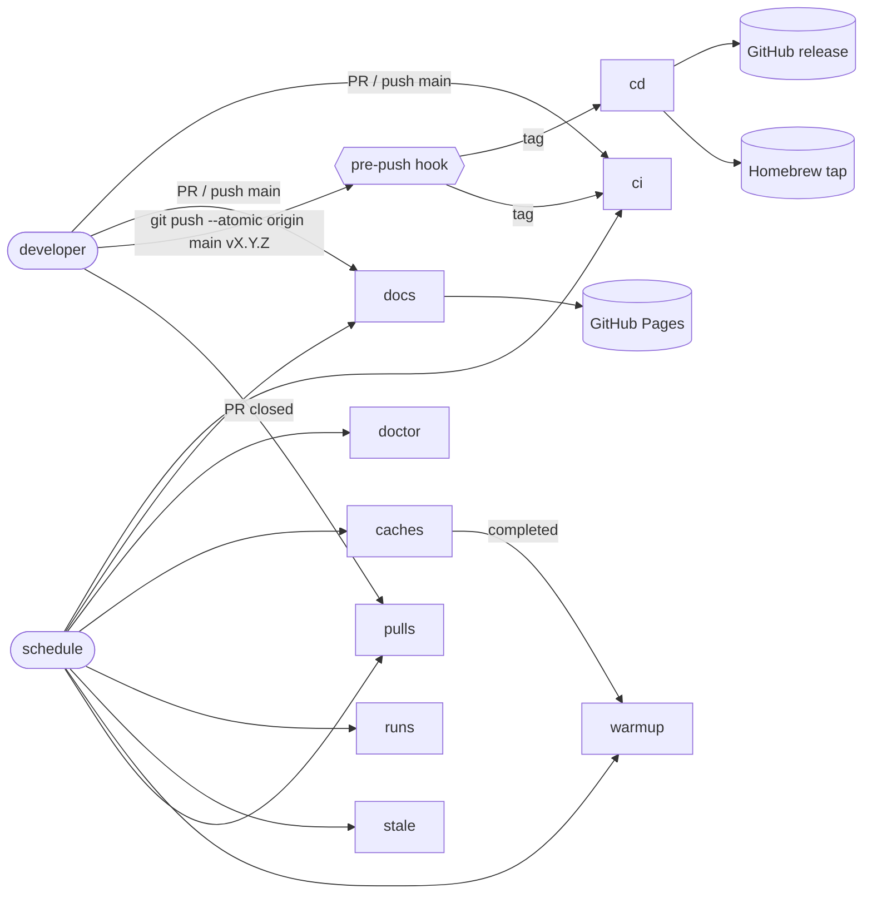
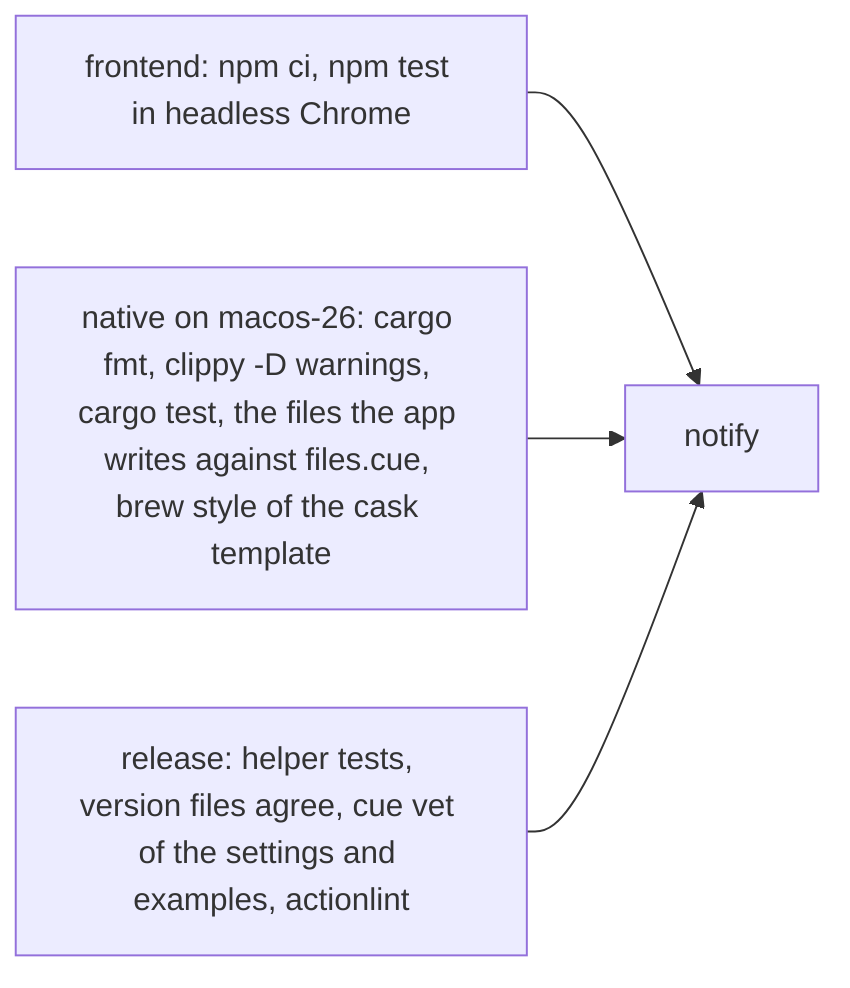
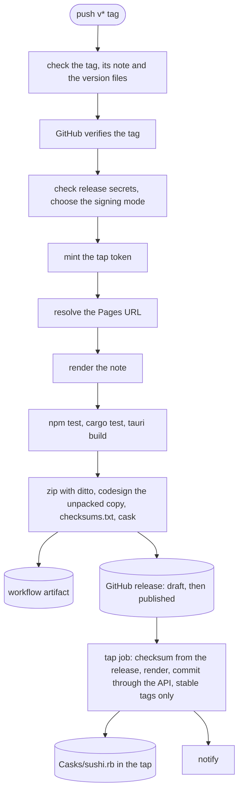
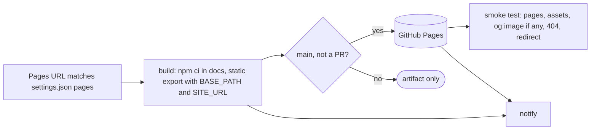
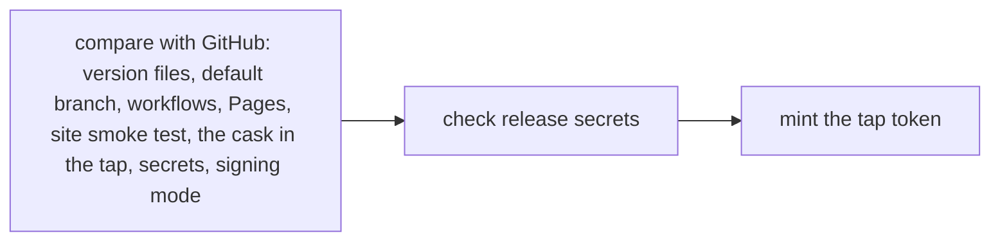
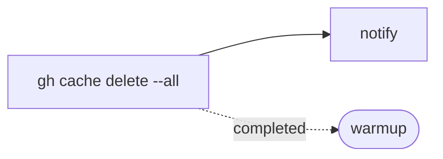
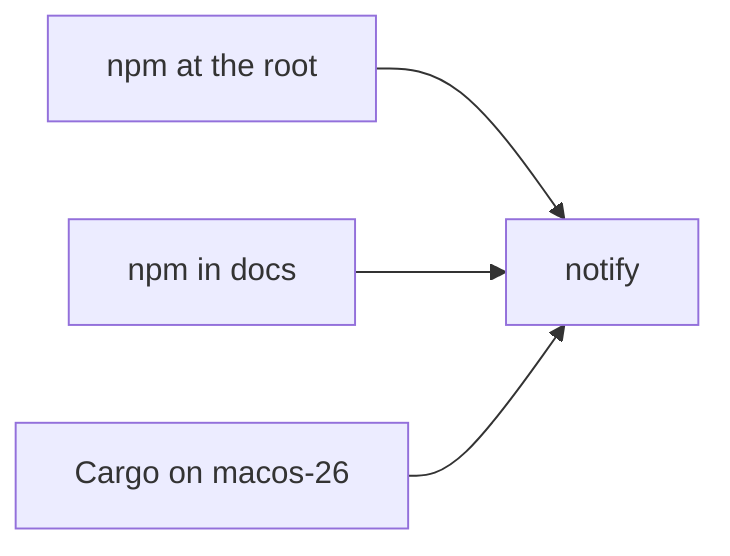
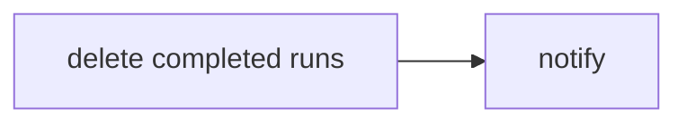
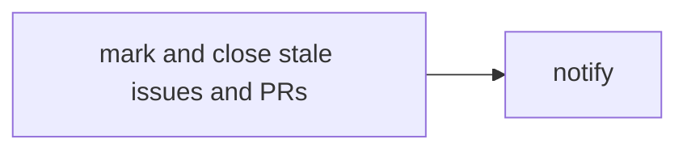

# GitHub Actions

| Workflow | Name | Runs on | Does |
| --- | --- | --- | --- |
| [ci](#ci) | Continuous integration | PR and push to main (app, shipped examples, specifications, tests, release inventory), `v*` tag, monthly, manual | Frontend tests in headless Chrome, Rust format, lint and tests, the cask template, release helpers, acceptance scenarios, settings and workflows |
| [cd](#cd) | Continuous delivery | `v*` tag, manual | Check the tag, build and package the app, publish the release and the Homebrew cask; a snapshot on manual runs |
| [docs](#docs) | Documentation delivery | PR and push to main (`docs/`, the app's `index.html`, `src/`, `package.json`, `tsconfig.json`), monthly, manual, reusable | Build the site; deploy it to Pages from main |
| [doctor](#doctor) | Repository doctor | daily, manual | Compare the repository with GitHub and explain fixes |
| [caches](#caches) | Workflow caches cleanup | monthly, manual, reusable | Delete all Actions caches |
| [warmup](#warmup) | Workflow caches warmup | after caches cleanup, push to main (`src-tauri/Cargo.lock`), twice a week, manual | Refill npm and docs caches; keep the Cargo cache warm |
| [pulls](#pulls) | Pull request caches cleanup | PR closed, daily, manual | Delete the caches of closed PRs |
| [runs](#runs) | Workflow runs cleanup | monthly on day 2, manual, reusable | Delete completed runs, with a dry run |
| [stale](#stale) | Stale issues cleanup | daily, manual, reusable | Mark and close stale issues and PRs |

Schedules are in UTC: cleanups and the doctor at 06:00, checks at 07:00, monthly on day 1;
runs cleanup on day 2, so the runs of day 1 stay readable until then; the Cargo warmup on Mondays and Thursdays.



## Common ground

- All external actions use concrete release tags; Dependabot checks the
  `github-actions` ecosystem daily, as well as npm at the root and in `docs/`
  and Cargo in `src-tauri/`. Review upstream changes and the action contract
  before accepting an update.
- Linux jobs run on `ubuntu-24.04`. Jobs that compile the app or run its
  browser scenarios (they press ⌘← and ⌘Z as macOS editor keys) run on
  `macos-26` (Apple Silicon): its default Xcode 26 and macOS 26 SDK build the
  Liquid Glass window, and the image ships Rust, Node.js and Google Chrome.
  Move to the next image deliberately, after checking its Xcode in
  [actions/runner-images](https://github.com/actions/runner-images); a
  `-latest` label would move the SDK under a release.
- Node.js 24 everywhere; Rust is the runner's stable toolchain, and its
  version is part of the Cargo cache key.
- Workflow permissions default to `contents: read`; publishing and maintenance
  jobs request more explicitly.
- Every workflow except doctor and pulls ends with a `notify` job that posts to Slack.
  `SLACK_WEBHOOK` is optional: an empty value skips the notification. Commit
  messages and dispatch reasons reach the message through environment variables.
- Secrets are checked by `make doctor`, which prints how to create a missing one.

| Secret | Used by | Purpose |
| --- | --- | --- |
| `OCTOLAB_RELEASER_CLIENT_ID` | cd, doctor | Client ID of the GitHub App "OctoLab Releaser" that commits the cask to the tap named in `.github/settings.json` |
| `OCTOLAB_RELEASER_KEY` | cd, doctor | Private key of that App |
| `APPLE_CERTIFICATE` | cd, doctor | Optional: the Developer ID Application certificate with its private key, a `.p12` encoded with `base64` |
| `APPLE_CERTIFICATE_PASSWORD` | cd, doctor | Optional: the password of that `.p12` |
| `APPLE_SIGNING_IDENTITY` | cd | Optional: the identity to sign with, e.g. `Developer ID Application: Name (TEAMID)`; when empty, `cd` passes `Developer ID Application` in place of the `"-"` of `tauri.conf.json`, so the certificate's own identity is used and any other kind of certificate is refused; ignored in ad-hoc mode |
| `APPLE_API_ISSUER` | cd, doctor | Optional: the Issuer ID of an App Store Connect API key, for notarization |
| `APPLE_API_KEY` | cd, doctor | Optional: the Key ID of that API key |
| `APPLE_API_PRIVATE_KEY` | cd, doctor | Optional: the contents of its `AuthKey_<Key ID>.p8` |
| `SLACK_WEBHOOK` | all but doctor and pulls | Notifications, optional |

The `APPLE_*` secrets are all or nothing, except `APPLE_SIGNING_IDENTITY`:
with none of them `cd` builds the ad-hoc signed app of `tauri.conf.json`; with
all of them it signs with Developer ID, notarizes and staples; with some of
them it stops before building.

### Set up GitHub

Nothing here is stored in the repository, so a fresh repository or a fork needs it once:

1. Settings → Pages → Source: **GitHub Actions**; the `github-pages` environment
   must allow deployments from main. Custom domain: `sushi.octolab.org`,
   declared as `pages.cname` in `.github/settings.json`, with Enforce HTTPS on.
2. `OCTOLAB_RELEASER_CLIENT_ID` and `OCTOLAB_RELEASER_KEY`: the Client ID and a
   private key of the GitHub App "OctoLab Releaser", owned by `octolab`, with
   no webhook and Repository permissions → Contents: Read and write, installed
   on `octolab/homebrew-tap`. Save both as secrets of the `octopot`
   organization available to this repository. The release itself uses the
   workflow token.
3. Branch protection of main: require signed commits; `.github/settings.yml`
   cannot set it.
4. Optional, for Developer ID: the `APPLE_*` secrets above as repository
   secrets. They need a paid Apple Developer Program membership, a Developer ID
   Application certificate exported with its key, and an App Store Connect API
   key with the Developer role.
5. Enable the workflows that were disabled by hand, after pushing the YAML that
   should run: `gh workflow enable <file> -R octopot/sushi`. The doctor
   reports every workflow that is not active, except those that
   `workflows` in `.github/settings.json` keeps off on purpose.

Then dispatch ci and docs, run doctor after the first Pages deployment
(`make workflow-doctor`), and dispatch cd on main for a snapshot. Do not
dispatch the cleanups to try them out: they delete data.

## ci

[ci.yml](ci.yml) keeps the main branch green.



- Runs on PRs and pushes to main that touch the app (`src/`, `src-tauri/`,
  `index.html`, the npm manifests, `tsconfig.json`), the shipped examples the
  frontend imports and the app embeds (`docs/specs/examples/`, with their
  schema `docs/specs/files.cue`), the specifications and their acceptance
  scenarios (`docs/specs/*.md`, `docs/specs/*.feature`), the tests, the
  `Makefile` or the release inventory in `.github/`; on `v*` tags; monthly;
  manually.
- Every gate of the release runs here first: a broken release helper or hook,
  version files that disagree, a cask template `brew style` rejects or an
  invalid workflow fails on main, not on the tag.
- The release job also checks the acceptance scenarios against the
  specifications (`scenarios.mjs lint`): a scenario tagged with a rule that no
  longer exists, or a `PR-n` in a specification without a scenario, fails.
- `npm test` uses the Google Chrome of the runner image; the model and the
  system calls are stubbed. The Rust test that edits through a running Ollama
  is `#[ignore]`d and runs only in `npm run test:local`.
- The native job restores the Cargo cache that [warmup](#warmup) saves on
  main; it never saves one, so PR caches stay small.
- PRs get no notification.

## cd

[cd.yml](cd.yml) publishes a release from a tag.



- **A release is a curated note plus a tag.** Write `docs/content/changelog/<tag>.md`:
  frontmatter `title` and `description`, the first line `# <title>`, Markdown
  and HTML, no MDX, site-relative links. Set the version in every file of
  `x-release.versions`. Commit it, tag the commit with a signed tag, run
  `make release-check TAG=<tag>`, then push the branch and the tag in one go:
  `git push --atomic origin main <tag>`.
- **Guardrails come first and fail in seconds.** `make release-check` checks the
  tag against the local branch before it is pushed. The `pre-push` hook
  (`.github/hooks`, wired by `make git-hooks`, part of `make setup`) runs
  `.github/scripts/release.mjs check` against the branch of the same push,
  then `make verify`. The first steps here repeat the tag check against
  `origin` for pushes that bypassed the hook, check that GitHub verifies the
  tag's signature, check the secrets and mint the tap token, all before
  anything is compiled.
- **The note becomes the release.** `release.mjs render` strips the frontmatter
  and the H1 and makes site links absolute from the Pages URL; `gh release
  create` takes the title and the body from it.
- **Policy lives in `.github/settings.json`**, documented by `.github/settings.cue`:
  tag pattern, maintenance branches, note path, the version files, the bundle
  and archive names, the tap and the cask template.
- **One archive, Apple Silicon only.** `npm run bundle` (`tauri build
  --bundles app`) builds `Sushi.app`; `release.mjs package` packs it with
  `ditto -c -k --sequesterRsrc --keepParent`, so the signature survives,
  unpacks it again and requires `codesign --verify --deep --strict` to pass on
  the unpacked copy, then writes `checksums.txt` and the cask for those bytes.
  The workflow artifact keeps all three for 90 days, snapshots included.
- **Draft first, published last.** The release is created as a draft with both
  assets and published only then. A run that fails in between leaves a draft,
  which the rerun deletes and recreates; a published release is never
  touched again, and a rerun that finds it published only checks that both
  assets are there.
- **The cask comes from the published bytes.** The `tap` job downloads
  `checksums.txt` and the archive from the release, checks one against the
  other, renders `.github/homebrew/sushi.rb` with the version and that
  `sha256`, keeping the quarantine step unless the archive holds a stapled
  notarization ticket (`Contents/CodeResources`), and commits it to `Casks/sushi.rb` through the contents API with a
  token minted per run by `actions/create-github-app-token` from the
  Releaser App. No author or committer is sent, so GitHub signs the commit as
  the App. The same text in the tap is a no-op; a newer version there is
  refused, never downgraded. While `x-release.tap.renamed_from` names old
  tokens that the tap still has, or that `cask_renames.json` does not map
  yet, the job writes the cask, deletes the old cask files and maps them in
  `cask_renames.json` in one commit through GraphQL `createCommitOnBranch`
  (no author either), so the tap never holds both casks; a rerun after that
  commit is an ordinary update. The job is separate so that a failed publication
  can be rerun alone (`gh run rerun <run-id> --failed`) while the release
  stays as it is.
- **Prereleases leave the tap alone.** A tag with a prerelease suffix, such as
  `v0.2.0-rc1`, is published with `--prerelease --latest=false`; the `tap`
  job is skipped, and the preflight does not require the App's secrets.
- **Signing.** Without the `APPLE_*` secrets the app is ad-hoc signed with the
  hardened runtime (`signingIdentity: "-"` in `tauri.conf.json`). Gatekeeper
  refuses an ad-hoc app that carries the quarantine attribute, which Homebrew
  sets on every cask download and no longer lets users skip: the cask
  removes it in `preflight_steps` before installing `Sushi.app`. With all of
  them, `tauri build` signs with Developer ID, notarizes through the App Store
  Connect API and staples the ticket, `cd` requires `stapler validate` and
  `spctl --assess` to pass, and the cask is rendered without that step.
- A manual run, on a branch or on a tag, builds a snapshot and publishes
  nothing: no release, no cask. Its workflow artifact holds the archive,
  `checksums.txt` and the cask.

## docs

[cd.docs.yml](cd.docs.yml) builds the Nextra site and deploys it to GitHub Pages.



- Runs on PRs and pushes to main that touch `docs/` (the panel's settings and
  saved prompts come from `docs/specs/examples/`), the app's `index.html`,
  `src/` and `tsconfig.json` (the landing page embeds the panel built from
  them), the root `package.json` (the build stops when its dependencies differ
  from `docs/package.json`), `.github/settings.json`, `release.mjs` or the
  notify action; monthly; manually; as a reusable workflow.
- The build is `npm --prefix docs run build` with `TARGET=static`; the output
  is `docs/dist/`.
- On main, `BASE_PATH` and `SITE_URL` come from the Pages configuration; PR
  previews take them from `.github/settings.json` (`release.mjs site-env`)
  and need no Pages access.
- No `CNAME` file is needed: a custom domain is set in Settings → Pages and
  declared as `pages.cname` in `.github/settings.json`; the build stops while
  they disagree. The domain is baked into the build, so rebuild after changing
  it: switch Settings → Pages first, then merge the new `pages.cname`.
- Independent of releases: merge a note and its new pages before tagging if the
  release must link to them from the first minute.

## doctor

[doctor.yml](doctor.yml) runs `release.mjs doctor` and `preflight` in CI; `make doctor` runs the first one locally, and `make workflow-doctor` dispatches the workflow on main and waits for its result.



- Daily and manual: a Pages domain change triggers no workflow, so a site
  built for the old domain is caught here. Each problem is printed with what
  to fix and where.
- The workflow token cannot list secrets, so they show as `unverified` there;
  the preflight step checks the ones a stable release needs, and minting the
  tap token proves the App is still installed on the tap with write access.
  Locally, `gh` sees the organization secrets shared with the repository.

## caches

[cleanup.caches.yml](cleanup.caches.yml) deletes every Actions cache with the built-in GitHub CLI.



## warmup

[warmup.caches.yml](warmup.caches.yml) refills the caches right after a successful cleanup.



- **The Cargo cache lives on main.** A tag can restore only caches of its own
  ref and of the default branch, so the cache that ci and cd restore is made
  here: the crates and `src-tauri/target` after clippy, the test build and
  `tauri build`, keyed by the runner OS, the Rust version and
  `src-tauri/Cargo.lock`. A push to main that changes the lockfile rebuilds
  it, incrementally from the previous one, and a run twice a week keeps it
  inside GitHub's 7-day eviction window. The npm jobs run only after a
  successful cleanup or on demand: `setup-node` saves the npm caches itself.

## pulls

[cleanup.pulls.yml](cleanup.pulls.yml) deletes the caches of a pull request once
it is closed: they are scoped to `refs/pull/<n>/merge` and of no use after it,
but count against the 10GB quota. It runs on `pull_request_target`, which keeps
a writable token when Dependabot closes its own PR, and checks out no code.
A run still in progress when its PR closes saves its caches afterwards, so a
daily run sweeps the caches of every PR that is no longer open.
It has no `notify` job, as it runs on every closed PR.

## runs

[cleanup.runs.yml](cleanup.runs.yml) deletes completed workflow runs, without age or count retention.



- To clear the history, run it with `pattern: All` (the default) and `dry_run`
  unchecked. Scheduled and reusable runs also target all workflows, Dependabot
  included. Active runs, including this one, remain.
- The upstream action also deletes orphaned runs of workflows that no longer
  exist, whatever their status or the selected workflow.

## stale

[cleanup.stale.yml](cleanup.stale.yml) marks inactive issues and PRs, then closes them.



- Issues and PRs with an assignee, a milestone or `status: pending` are exempt.
- [.github/integrations/stale/stale.yml](../integrations/stale/stale.yml) keeps
  the settings of the retired Stale app for reference; nothing reads it.

## Local checks

```sh
make verify                         # lint, npm test, cargo test, release helpers, scenarios, cue vet, actionlint
node --test .github/scripts/*.test.mjs
make dist                           # artifacts/: the archive, checksums.txt and the cask; nothing is published
make release-check TAG=vX.Y.Z       # after tagging, before the push
make doctor
```
